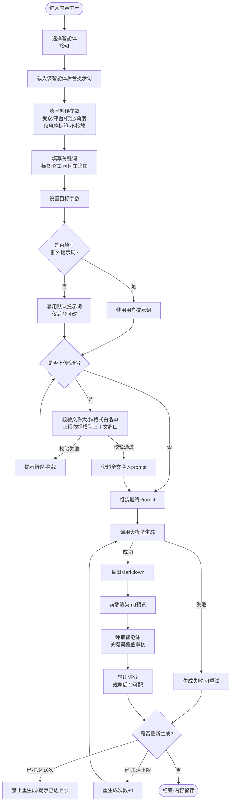
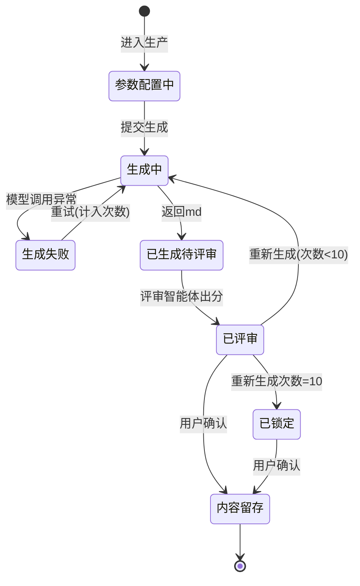

# 内容生产模块 · 流程图与状态机（POC）

> 范围：仅「内容生产模块」的 AI 生成链路。本期为初步验证版，不含自动发布、真实性核验、时效更新、query 细分、量级治理。
> 说明：本文件为需求梳理产物，仅描述「输入 → 组装 → 生成 → 评审」的事实流转，不含方案设计。

---

## 一、生成主流程图



---

## 二、Prompt 组装逻辑

```
最终Prompt =
    智能体基础提示词（后台配置）
  + 创作参数映射约束句（受众/平台/行业/角度 → 风格·语气·结构）
  + 关键词列表（要求：原样命中 + 自然融入·禁止堆砌）
  + 目标字数（长度约束）
  + 额外提示词（无则默认提示词·仅后台可改）
  + 上传资料全文（可选·受大小与格式白名单约束）
```

---

## 三、单篇内容状态机



### 状态说明

| 状态 | 含义 | 进入条件 | 可执行动作 |
|------|------|----------|-----------|
| 参数配置中 | 用户填写智能体/参数/关键词/字数/提示词/资料 | 进入模块 | 提交生成 |
| 生成中 | 已组装 prompt，调用模型 | 提交生成 / 重试 / 重新生成 | 等待返回 |
| 生成失败 | 模型调用异常 | 调用失败 | 重试（计入重生成次数） |
| 已生成待评审 | 模型返回 md，前端预览 | 生成成功 | 触发评审 |
| 已评审 | 评审智能体完成关键词审核并出分 | 评审完成 | 重新生成 / 确认留存 |
| 已锁定 | 单篇重新生成已达 10 次上限 | 重生成次数=10 | 仅可确认留存·禁止再生成 |
| 内容留存 | 用户确认该版内容 | 用户确认 | 结束 |

---

## 四、次数限制规则

- **限制对象**：单篇内容的「重新生成」次数。
- **上限**：10 次。
- **计数口径**：每次成功或失败触发模型生成均计 1 次（失败重试同样计入）。
- **达上限后**：禁止再次生成，仅允许在已产出版本中确认留存。

> 备注：本期为初步验证，「关键词能搜到原文」验证的是内容【可被检索】，不等于 GEO 的【被 AI 引用/正向复述】。后续做效果衡量时口径需另行升级。
